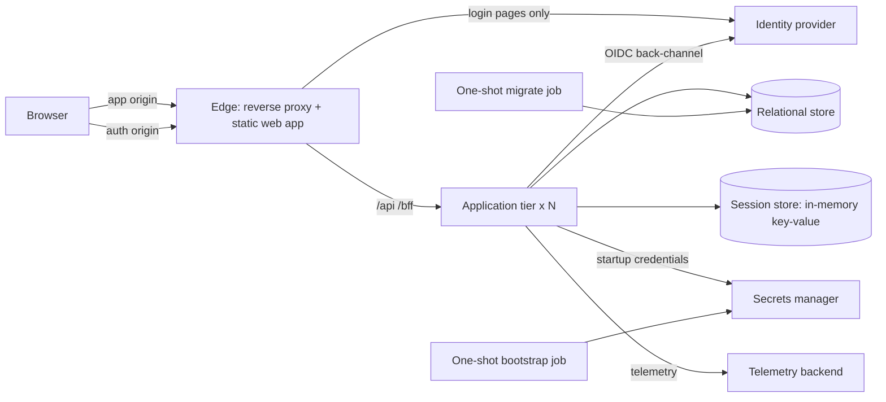
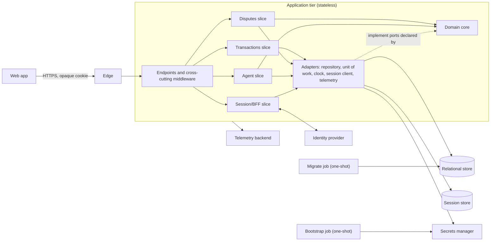
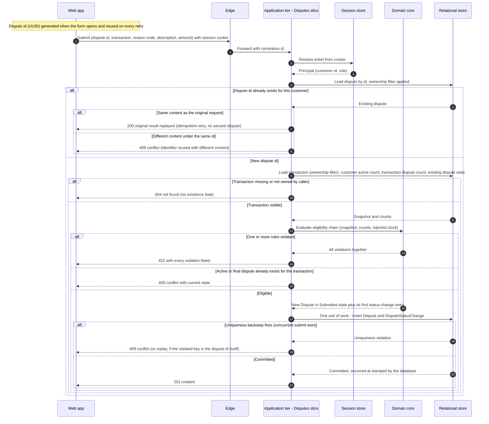
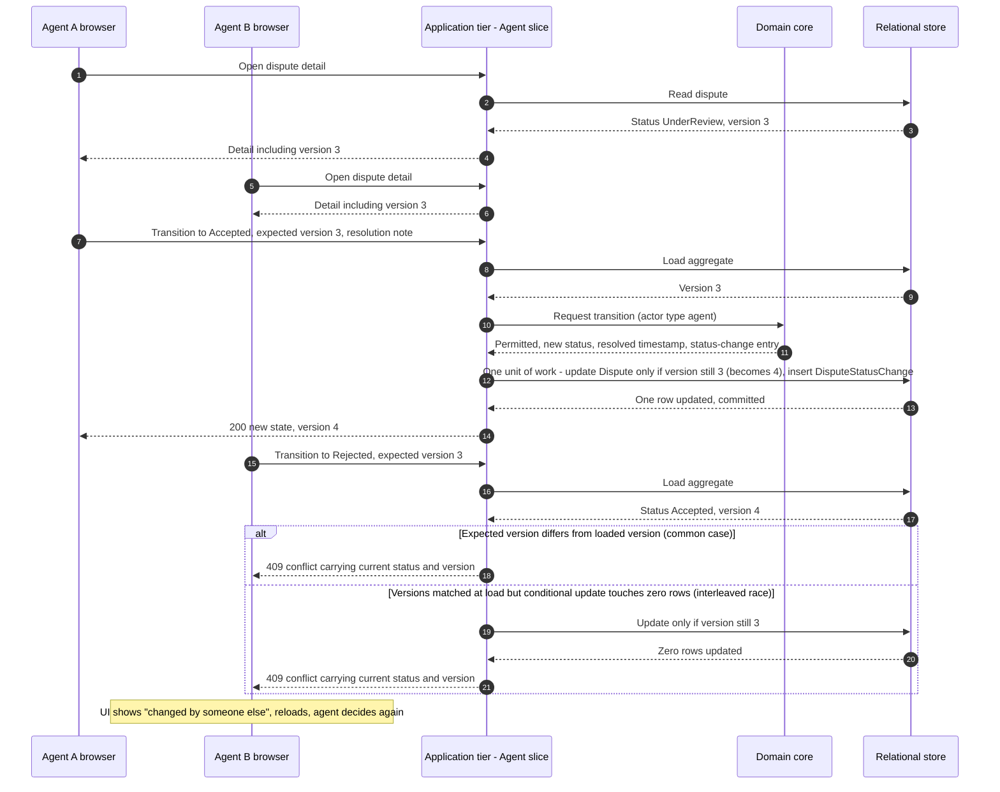
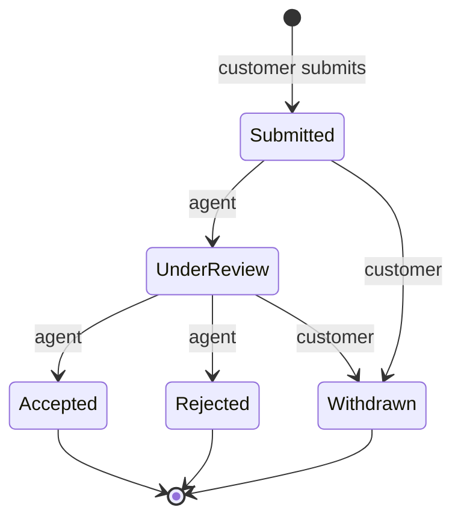
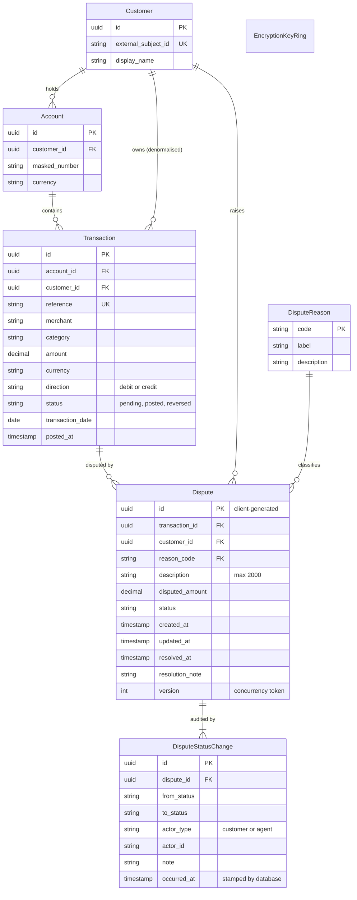
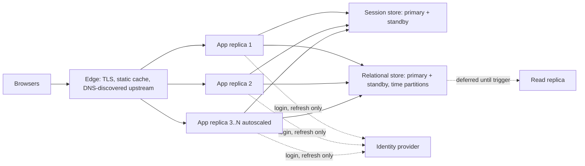
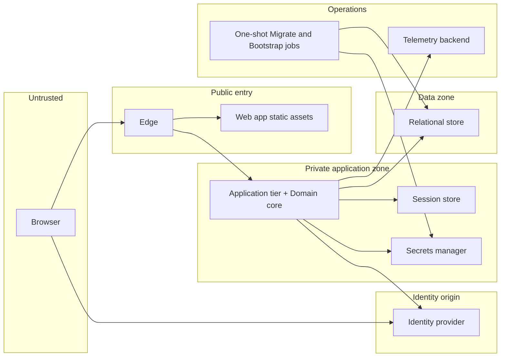

# Transactions Dispute Portal — System Design

> Technology-neutral blueprint: components and technology *categories* with trade-offs, no code. Concrete choices
> and their rationale are recorded as architecture decision records in [decisions/](../decisions/). Capacity figures
> are assumptions; every scaling decision cites the figure that motivates it.

**One-line problem.** Customers view their bank transactions and dispute them, with a historic view of every dispute;
back-office agents review and resolve disputes.

## 1. Requirements

**Problem.** Customers of a retail bank need to see their card/account transactions and raise a dispute on one they do
not recognise or that went wrong, then follow the dispute's progress. Back-office agents need to review and resolve them.

### 1.1 Functional (elicit → classify → validate)
| ID | Requirement | Class |
|---|---|---|
| FR-1 | A customer lists and opens only their own transactions, newest first, filtered by date range and status | Core |
| FR-2 | A customer submits a dispute on an eligible transaction with a reason, a description and an optional partial amount | Core |
| FR-3 | Eligibility is a set of independent business rules whose violations are reported together | Core |
| FR-4 | A customer sees all their disputes (historic view) and each dispute's timeline of status changes | Core |
| FR-5 | A customer withdraws a dispute that is not yet resolved | Core |
| FR-6 | An agent sees a queue of disputes across customers and moves a dispute through review to a resolution with a note | Core |
| FR-7 | Users sign in and out through an external identity provider; roles distinguish customer from agent | Core |

### 1.2 Non-functional
| ID | Requirement | Measure |
|---|---|---|
| NFR-1 | Confidentiality: a customer can never read another customer's data; tokens are never exposed to the browser | Zero cross-customer reads in tests; no token reachable from page script |
| NFR-2 | Integrity: at most one active dispute per transaction under concurrent submits; status history cannot be altered | Concurrency and permission tests |
| NFR-3 | Availability | 99.9% monthly (assumed) |
| NFR-4 | Latency | p95 ≤ 300 ms reads, ≤ 500 ms writes at the peak in §2 |
| NFR-5 | Scalability: horizontal scale of the stateless tier without sticky sessions | Replica test |
| NFR-6 | Auditability and privacy: who changed what and when; no personal data in logs; agent views are recorded | Audit table, log tests |
| NFR-7 | Operability: one-command start; health, metrics, traces and logs correlate by one id | Clean-clone run |

### 1.3 Extended / operational
Structured logging and tracing; alerting on error rate, latency and security events; backup and restore with stated
RPO/RTO; rate limiting per user; no feature flags (YAGNI); analytics deferred.

### 1.4 SRS quality gate
- **Clarity:** each requirement has one measurable outcome. **Consistency:** FR-5 and FR-6 share one lifecycle (§4.2), so no contradictory transitions. **Completeness:** every FR maps to an HLD component (§3) and an API operation (§7); every NFR maps to a cross-cutting control (§8) and a verification (§8b).

### 1.5 Out of scope
Attachments/evidence upload, customer notifications, chargeback scheme integration, multi-currency conversion, onboarding.

## 2. Capacity estimation `[ASSUMED]`
| Quantity | Assumption | Derived |
|---|---|---|
| Customers | 2,000,000 | |
| Daily active users | 10% = 200,000 | |
| Reads per active user per day | 15 list/detail views | 3,000,000 reads/day ≈ 35/s average |
| Peak factor | ×3.5 | **≈120 read requests/s at peak** |
| Disputes | 0.1% of transactions; ≈2,700/day | peak **≈1 write/s** |
| Read:write ratio | | **≈400:1** |
| Transactions per customer per month | 40 | 80M rows/month |
| Row size | ≈300 bytes with indexes | **≈24 GB/month** growth |
| Concurrent sessions | 10% of DAU | 20,000 × ≈4 KB ≈ **80 MB** of session state |
| Dispute rows | 2,700/day × 365 | ≈1M/year, ≈1 GB/year with timeline |

Scaling decisions in §6 cite these figures by name (read:write ratio, storage growth, session state, peak RPS).

## 2b. Feasibility, estimation and risk
**Sizing (order of magnitude).** Seven bounded contexts-in-one-deployable; roughly 25 API operations, 9 tables, 6 screens.
Function-point style estimate ≈ 150 FP; at an assumed 1.5 FP/hour for a single engineer with an assistant, ≈ 100 engineer-hours.
The delivery window is one week, which is why scope is cut rather than stretched.

**Risk register**
| # | Risk | L | I | Mitigation |
|---|---|---|---|---|
| R1 | Identity provider issuer vs back-channel URL mismatch in containers | H | H | Spike first; issuer is the public URL, metadata fetched internally |
| R2 | Cross-customer data leak through a missing filter | M | H | Fail-closed ownership filter, architecture test, BOLA tests on every endpoint |
| R3 | Double submit or retry creates duplicate disputes | H | M | Client-generated id as idempotency key + database uniqueness backstop |
| R4 | Session theft or forgery via the session store | M | H | Encrypted tickets, key-scoped access, short lifetimes, refresh-bound revocation |
| R5 | Secrets leak into a public repository | M | H | Secrets manager only; scanning in hook and CI; placeholders only |
| R6 | Time: one week | H | M | Walking skeleton first, ramped cascade, explicit cut line |
| R7 | Unbounded growth of the transactions table | L | M | Keyset paging now; time partitioning documented as next step |

**Roles / accountability.** Owner (decisions, review), engineering assistant (drafts), independent reviewers (security,
code, verification) never self-approve.
**Feasibility checklist.** Technical constraints known (containers only); security-risk review done (threat model);
capacity estimated (§2); costing n/a (local + CI); timeline set (7 days).

## 3. High-level design
**Style.** A modular monolith behind an edge tier: one deployable application tier organised by feature, stateless
so it scales horizontally; state lives in a relational store (system of record) and an in-memory key-value store (sessions).

| Component | Responsibility |
|---|---|
| Edge | TLS termination in production, static assets, security headers, request ids, coarse rate limit, path allow-listing for the identity provider |
| Web app | Presentation only; no tokens, no business rules beyond input validation |
| Application tier | Authentication (as OIDC client for the browser), authorization, business rules, persistence, telemetry |
| Identity provider | Credentials, MFA policy, sessions, tokens, roles |
| Relational store | Customers, accounts, transactions (read model), disputes, immutable status history, encryption-key ring |
| Session store | Short-lived encrypted session tickets |
| Secrets manager | Runtime credentials for the application tier and the migrate job |
| Telemetry backend | Traces, metrics, logs |

**Request flow (list transactions).** Browser → edge (headers, request id) → application tier (session cookie → ticket
lookup → principal) → ownership filter → keyset query → read model → JSON → edge → browser. **Write flow (submit dispute):**
same path, then eligibility policy → aggregate → single transaction (dispute + history) → 201.

**Real-time.** N/A: status changes are pulled when the user opens a screen; push (polling vs server-sent events vs
bidirectional sockets) is a deferred trade-off for notifications.

## 4. Low-level design

Conforms to the frozen component and entity list. Entities and components are named exactly as in the architecture overview. The error envelope itself is specified once in the APIs section (Error contract). This section only maps conditions to it.

### 4.1 Component breakdown

| Component | Responsibilities | Collaborates with |
|---|---|---|
| Edge | TLS termination, routing of static assets vs API traffic, request-size and rate limits, attaches or accepts a correlation id on every request. Holds no business logic and no state. | Web app, Application tier |
| Web app | Customer views (transaction list, dispute form, my disputes, withdraw) and agent views (queue, dispute detail, transition). Generates the dispute identifier when the form opens, so a retry reuses it. Holds no tokens, only an opaque HttpOnly session cookie. Renders the structured error contract (field-level rule violations, "someone else changed this" refresh prompt). | Edge |
| Application tier | Stateless and horizontally replicable. Organised as vertical feature slices, each with its own endpoints, handlers, read projections and validation. See slice list below. | Domain core, Relational store, Session store, Identity provider, Secrets manager, Telemetry backend |
| Domain core | Pure business rules with no I/O: the Dispute aggregate root, the lifecycle state machine, the eligibility policy chain, and value types such as money and reason code. Time comes in through an injected clock abstraction. Persistence and identity are reached only through ports the core declares. | None directly. Called by slices. |
| Identity provider | External authority for customer and agent authentication (OIDC authorization-code flow). Supplies a stable subject identifier and a role assertion. | Session/BFF slice |
| Relational store | System of record for all domain entities and for the EncryptionKeyRing. Enforces constraints, uniqueness backstops, grants, and database-stamped time. | Application tier, one-shot jobs |
| Session store | In-memory key-value store holding session tickets: opaque key to encrypted payload, with TTL. Durable append-only persistence, no eviction. | Session/BFF slice |
| Secrets manager | Holds the database credentials (one per privilege level), the OIDC client secret, and any bootstrap secrets. Injected at start-up, never baked into images or configuration files. | Application tier, jobs |
| Telemetry backend | Receives structured logs, metrics and traces, correlated by correlation id. | Every runtime component |
| Migrate job | One-shot. Runs with the only schema-changing (DDL) privilege: applies versioned migrations including the least-privilege grants, seeds DisputeReason reference data and the first EncryptionKeyRing entry (so replicas do not race at cold start), and in non-production seeds sample Customer, Account and Transaction rows with dates relative to the clock (Transaction is a read model that a core banking feed populates in reality). Exits. The long-running application never holds DDL rights. | Relational store, Secrets manager |
| Bootstrap job | One-shot and idempotent, runs before everything else. Generates any missing secret, initialises and unseals the secrets manager, writes the credentials for each privilege level, and creates the machine identities (one per application-tier job) with network-bound, expiring credentials. Locally it is the trusted orchestrator that delivers the first credential ("secret zero"). | Secrets manager |

**Application tier slices**

- **Transactions slice** (queries only):
  - Keyset-paged "my transactions" list and transaction detail, as read projections.
  - Reports per-transaction dispute state so the UI can show "already disputed".
  - Never writes, because Transaction is a read model.
- **Disputes slice** (customer commands and queries):
  - Submit dispute (idempotent), withdraw dispute, list my disputes (keyset), dispute detail with status history.
  - Commands load or create the Dispute aggregate. Queries bypass it.
- **Agent slice** (agent commands and queries):
  - Queue (oldest first, filterable by status), dispute detail, and transitions to UnderReview, Accepted and Rejected with a resolution note.
  - Reaches the same aggregate and repository as the Disputes slice. The coupling is intentional and goes through the aggregate, not through slice internals.
- **Session/BFF slice**:
  - The application tier is the OIDC client: login redirect, callback and code exchange, ticket issuance, logout, current-principal lookup.
  - Anti-forgery check on state-changing calls.
  - Tokens and principal live only inside the encrypted ticket payload in the Session store.
  - The ticket id in the cookie is opaque and carries no claims.

**Conceptual entities and ownership**

- **Aggregate.** Dispute is the aggregate root. Its append-only DisputeStatusChange entries belong to it and change only through it.
- **References.** Dispute refers to Transaction and Customer by identifier only. Transaction is outside the aggregate, so eligibility reads a snapshot of it through a read port and never mutates it.
- **Reference data.** DisputeReason is static reference data.
- **Ownership chain.** Customer owns Accounts. Account holds Transactions. Transaction carries a denormalised customer reference so ownership checks and the customer-keyed index need no join.
- **Infrastructure.** EncryptionKeyRing is infrastructure and sits outside the domain model. It exists to protect session ticket payloads.

**Dependency direction**

The arrows show compile-time dependencies. The Domain core depends on nothing. Adapters depend on the core's ports, not the reverse.

### 4.2 Interactions

#### Submit a dispute, with idempotent retry

Notes on the flow:

- **Idempotency.** The client-generated identifier is the dispute's primary key, so no separate idempotency table is needed. A lost response followed by a retry finds the existing row and replays it. Two copies of the same retry racing each other collide on the primary key. The loser re-reads and replays instead of failing.
- **All violations together.** The chain evaluates every rule and returns the full list in one 422, so the customer fixes everything in one pass.
- **Conflict is not a rule violation.** "An active or final dispute already exists" is a state check outside the chain. It returns 409 with the current state of the existing dispute, because the request conflicts with what exists. The request is not ineligible under policy.
- **Two kinds of limit.** The one-active-dispute-per-transaction rule is an integrity invariant. The partial unique index backs it, so it holds even if the application check races. The 20-active-per-customer and 3-per-transaction limits are policy ceilings. They are counted inside the unit of work. At about 1 peak write/s a narrow lock on the Customer row for the unit's duration closes the race at negligible cost. The alternative is accepting a rare overshoot of the ceiling. The lock gives a hard cap, and the overshoot saves a lock but weakens the guarantee.

#### Agent transition with stale-version rejection

Notes on the flow:

- **Both detection points.** The cheap comparison at load time catches almost all stale requests. The conditional write in the database catches the rest. Neither relies on a lock held across the two agents' think time.
- **Illegal transitions.** A request that is stale and also illegal, such as moving a terminal dispute, gets the same 409 with the current state. The state machine, not the UI, decides what is legal.
- **Customer withdrawal.** A customer withdraw racing an agent transition resolves the same way. Whoever commits first wins, and the other receives 409.
- **Retries after a lost response.** The retry arrives with a stale version and gets 409. The client reloads, sees its own transition applied, and stops. Transitions are therefore safe to retry without an idempotency key.

#### Lifecycle state machine

The machine is a data table keyed by (from, to, actor type), held inside the Dispute aggregate. It is not scattered conditionals.

| From | To | Permitted actor | Effects |
|---|---|---|---|
| Submitted | UnderReview | agent | Status change appended |
| UnderReview | Accepted | agent | Resolved timestamp and resolution note set, status change appended |
| UnderReview | Rejected | agent | Resolved timestamp and resolution note set, status change appended |
| Submitted | Withdrawn | customer | Resolved timestamp set, status change appended |
| UnderReview | Withdrawn | customer | Resolved timestamp set, status change appended |

Accepted, Rejected and Withdrawn are terminal. Only Withdrawn leaves the transaction open to a new dispute, which is a new Dispute with a new identifier. Accepted and Rejected are final for the transaction. Every transition bumps the concurrency version and appends exactly one DisputeStatusChange.

### 4.3 Design patterns and SOLID

| Pattern (conceptual) | Problem it solves | Trade-off axis |
|---|---|---|
| Aggregate root + state machine | Invariants (legal transitions, terminal states, resolved timestamp rules) must hold no matter which slice or caller touches a dispute. | Central correctness vs a slightly heavier model than "update a status column". |
| Specification/Strategy policy chain | Six eligibility rules must be individually testable, extensible, and all reported together. Each rule is one class behind a common contract, and the chain collects violations. | Extensibility and clarity vs more small classes than one validation block. |
| Aggregate-specific repository + unit of work | Persistence details stay out of the core. Dispute and DisputeStatusChange commit atomically or not at all. | Narrow, intention-revealing ports vs more classes than one generic repository. Unit of work centralises transaction boundaries but can hide them from readers. |
| CQRS-lite | Commands need the full aggregate and invariants. List and detail queries need cheap, index-shaped reads. Commands go through the aggregate. Queries are read projections straight from tables, in the same store, with no event sync. | Simple and consistent vs no independent read scaling. A separate read model is a later step if reads outgrow one store. |
| Append-only audit log (DisputeStatusChange) | Who changed what, when, as which actor, must be tamper-resistant and reconstructable. Grants permit insert only, and the database stamps the time. | Strong evidence vs permanent growth, handled by retention policy. |
| BFF (Application tier is the OIDC client) | Tokens must not live in browser-reachable storage. The browser holds only an opaque HttpOnly cookie, and tokens stay server-side in the ticket payload. | Smaller attack surface vs server-held session state, which needs the Session store. |
| Optimistic concurrency + database uniqueness backstop | Concurrent agents or a customer racing an agent must not silently overwrite each other. Concurrent submits must not create two active disputes. | No locks across human think time vs conflicts surfaced to users as 409 and a refresh. |
| Idempotency via client-generated identifier | Network retries and double clicks must not create duplicate disputes. The dispute's own id doubles as the idempotency key. | No extra table or expiry job vs trusting clients to generate unique ids (the ownership filter prevents cross-customer abuse). |
| Ownership as a central, fail-closed query filter | A forgotten per-query ownership check is the classic cross-customer data leak. Scoping lives in one place and derives from the authenticated principal. A missing principal yields no rows, never unfiltered rows. Agents reach all-disputes data through separately named, role-gated queries. | One place to get right vs less per-query flexibility. Database-level row security can be layered on for depth, at the cost of per-request context on pooled connections. |
| Dependency injection with options | Wiring happens in one composition root. The clock, repositories and tunables (120-day window, 20 and 3 limits, session lifetime) are injected, so tests substitute them and operators change them without code edits. | Testability and configurability vs indirection and start-up validation requirements. |
| No mediator library | There are about a dozen operations. Endpoints call slice handlers directly, and cross-cutting concerns (auth, correlation, validation, error mapping) live in middleware. | Fewer moving parts and traceable call paths vs losing a ready-made pipeline-behaviour hook. Revisit if handler count or cross-cutting pipeline needs grow. |

**SOLID mapping**

| Principle | Where it shows up |
|---|---|
| Single responsibility | One class per eligibility rule. One slice per feature area. The Domain core does rules only and the adapters do I/O only. |
| Open/closed | A new eligibility rule is one new class registered in the chain. A new lifecycle transition is a new table row. Neither edits existing rules or transitions. |
| Liskov substitution | Every rule honours the same contract: it inspects the candidate and returns zero or more violations, never throws for a normal violation, and never depends on another rule's order. Any rule can replace another in the chain. |
| Interface segregation | Slices depend on narrow ports: a transaction reader, a dispute repository, a clock, a session client. The list-only Transactions slice cannot reach dispute writes. |
| Dependency inversion | The Domain core declares the ports and the adapters implement them. The composition root binds them with injected options. |

### 4.4 Error handling and validation strategy

**Layered validation.** Each layer rejects what it alone can know, cheaply and early.

1. **Edge.** Size limits, rate limits, protocol sanity.
2. **Request shape.** Types, required fields, identifier format, length bounds (description at most 2000, amount positive). Result: 400.
3. **Authentication.** Missing, expired or unknown ticket. Result: 401.
4. **Authorisation and ownership.** Role not permitted for the operation gives 403. A resource outside the caller's ownership gives 404, so existence is not revealed.
5. **Domain rules.** The eligibility chain returns every violation. Result: 422.
6. **State and concurrency.** State conflicts, stale versions, uniqueness backstop. Result: 409.
7. **Infrastructure.** Dependency unavailable or timed out gives 503 with a retry hint. An unexpected fault gives 500 with no internals disclosed.

**One structured error contract.** Every non-success response carries the same envelope: a stable machine-readable code, a human message, the correlation id, and an optional details block. The details block is a list of violations for 422 and the current state (status, version) for 409. Field-level 400s list the offending fields. The correlation id is also returned as a response header and appears in logs and traces, so a user-reported id leads straight to the trace.

| Condition | Status | Details carried |
|---|---|---|
| Malformed or out-of-bounds input | 400 | Offending fields |
| No valid session | 401 | None |
| Wrong role for operation | 403 | None |
| Resource missing or not owned | 404 | None |
| Eligibility rule violation(s) | 422 | Every violated rule, with its code and message |
| Conflict with current state (duplicate or final dispute, illegal transition, stale version, uniqueness backstop, identifier reused with different content) | 409 | Current status and version |
| Rate limit exceeded | 429 | Retry hint |
| Dependency unavailable | 503 | Retry hint |
| Unexpected fault | 500 | Correlation id only |

**Principles**

- **409 vs 422.** 409 means the request is fine in isolation but conflicts with what exists. 422 means the request is well-formed but the policy forbids it. The UI reacts differently to each: refresh vs fix-and-resubmit.
- **Domain errors are values.** The core returns violations and does not throw them. Exceptions are reserved for genuine faults.
- **Fail closed.** Missing principal, missing ownership scope or a failed authorisation lookup denies the request. Errors never default to allowing it.
- **Safe retries.** Submit is retry-safe through the identifier. Transitions are retry-safe through the version. Reads are naturally safe. 503 and 429 are the only retry-advised statuses.
- **No sensitive data in errors or logs.** Descriptions, tokens and full identifiers stay out. Logs carry ids, codes and the correlation id.

### 4.5 Design-quality lens

**High cohesion.**

- **Vertical slices.** Everything a feature needs (endpoint, handler, projection, validation) lives together, so a change to the agent queue touches the Agent slice only.
- **Rules in one place.** All dispute rules live in the Domain core, and nothing else decides eligibility or legality.
- **Cohesive adapters.** Each adapter has one reason to change, such as the database schema, the session ticket format or the OIDC provider.

**Low coupling.**

- **Narrow dependencies.** Slices share the Domain core and a small set of ports, and never each other's internals.
- **Dependencies point inward.** Nothing in the core knows about HTTP, SQL, the Session store or the Identity provider. Swapping any adapter touches no business rule.
- **No hidden global state.** The clock and options arrive by injection, so time-dependent rules (120-day window) are deterministic in tests.
- **Known coupling points.** The Disputes and Agent slices both operate on the Dispute aggregate. The Web app depends on the error contract's shape. Both are deliberate and documented.

**Function- vs object-oriented decomposition.**

- **Objects** carry state and invariants together: the Dispute aggregate with its state machine, and the rule objects in the chain. This gives encapsulation, extension by adding classes, and discoverable structure.
- **Functions** carry stateless transformations: read projections, request-to-command mapping, error-to-envelope mapping, and per-rule evaluation logic where it needs no state. This gives easy composition, simple tests and less ceremony.
- **Axis.** Object orientation favours extension and encapsulated invariants. Functional style favours simplicity and testability for stateless steps.
- **Chosen split.** Objects where state and invariants must travel together, functions for stateless flows. Code-level quality metrics (cyclomatic complexity and similar) are handed downstream.

---

## 5. Database design

### 5.1 Per-domain store decision

Decisions are made per data domain, by category, driven by access pattern, consistency need and scale. Capacity inputs: about 120 peak read RPS, about 1 peak write/s (read:write about 400:1), about 24 GB/month Transaction growth, about 1M disputes/year, and about 80 MB of session state at 20k concurrent sessions.

| Data domain | Category | Why this category | Trade-off axis |
|---|---|---|---|
| Customer, Account, Transaction, Dispute, DisputeStatusChange, DisputeReason | **Relational** | Atomic multi-row commands (Dispute plus its first DisputeStatusChange). Enforced integrity (foreign keys, CHECK constraints, unique keys, and a partial unique index so only one active dispute exists per transaction). Strong read-after-write consistency. Row-version optimistic concurrency. Least-privilege grants, including column-scoped insert on DisputeStatusChange so the database, not the caller, stamps `occurred at`. Flexible ad hoc filtering and sorting for the agent queue. | Integrity and consistency vs write scale-out and schema flexibility. At about 1 peak write/s and about 1M disputes/year, write scale-out is not the constraint. |
| Session tickets | **Key-value, in-memory** | Pure point lookup by opaque key. Native TTL expiry. Encrypted payload. Access scoped to the session key space. Durable append-only persistence, so a restart does not log everyone out. No eviction, so a full store rejects writes visibly and never silently drops live sessions. About 80 MB at 20k sessions is trivial for memory. | Latency and native expiry vs richer query capability. Durability setting trades write latency against the window of sessions lost on a crash, and losing sessions only forces re-login. |
| EncryptionKeyRing | **Relational** | It is the trust root for decrypting and issuing tickets. Keeping it outside the Session store means that write access to the Session store alone cannot plant a key and forge sessions. It also inherits the relational store's grants, backup and audit. | Isolation of the trust root vs a small extra dependency at start-up and refresh (keys are cached in-process, so it is off the request path). |

**Why not the other categories**

- **Relational for session tickets.** Viable at this load, so this is a judgement call. Per-request session lookups plus sliding-expiry writes and TTL sweeps would add churn on the system of record. They would also couple every authenticated request to the primary's availability. A separate in-memory store isolates both.
- **Key-value for the core domain.** It has no multi-row atomicity, no foreign-key or CHECK enforcement, no partial unique constraint and no ad hoc queue queries. Every one of those would be rebuilt in application code.
- **Document.**
  - A Dispute plus its history looks aggregate-shaped, but the integrity the system depends on spans aggregates: one active dispute per transaction, ceilings per customer, and ownership chains Customer to Account to Transaction.
  - The schema is stable, so schema flexibility buys little.
  - Agent queue queries need multi-attribute filtering and ordering across documents.
  - Document stores trade cross-document integrity for flexibility, which is the wrong trade here.
- **Wide-column.**
  - It excels at very high write throughput and time-series scale-out. This system peaks near 1 write/s.
  - It requires query-first modelling and denormalisation, offers limited secondary indexing and weak multi-row transactions, and would still not meet the uniqueness backstop need.
  - Operational cost without a matching benefit.
- **Graph.** Relationships are shallow and fixed-depth (Customer, Account, Transaction, Dispute), and no query traverses variable-length paths. Graph storage adds operational weight without query benefit. A future fraud-ring analysis feature would be the trigger to revisit, as a side projection and not a replacement.

**Scope note.** One logical relational store serves the Application tier, with tables owned by slice and no cross-slice table sharing beyond the Dispute aggregate. Splitting the store per slice would add distributed-consistency cost with no load justification.

### 5.2 Conceptual data model

EncryptionKeyRing is infrastructure and intentionally stands apart from the domain model. It has no relationships to domain entities. Its attributes are an implementation detail and are not modelled here.

**Model notes**

- **Transaction as a read model.** Rows are fed from a core banking system and treated as read-only by the application. The denormalised customer reference must agree with the owning Account's customer. The feed or a composite reference enforces this so the invariant cannot drift.
- **Initial status change.** The first DisputeStatusChange for a dispute has no meaningful "from" value (creation), and every later one has both from and to.
- **Constraints at the database level.**
  - CHECK constraints on enumerations: direction, transaction status, dispute status, actor type.
  - CHECK on amounts: positive, and `disputed amount` positive.
  - Bounded description length.
  - Unique `external subject id` on Customer and unique `reference` on Transaction.
  - Partial unique on Dispute(transaction) where status is Submitted or UnderReview.
  - The cross-row rules (disputed amount at most transaction amount, the counts, the window) live in the Domain core, because the database cannot express them as row-local checks.
- **Privilege split (design level).**

| Role | Rights |
|---|---|
| Migrate job | One-shot. Runs with the only schema-changing (DDL) privilege: applies versioned migrations including the least-privilege grants, seeds DisputeReason reference data and the first EncryptionKeyRing entry (so replicas do not race at cold start), and in non-production seeds sample Customer, Account and Transaction rows with dates relative to the clock (Transaction is a read model that a core banking feed populates in reality). Exits. The long-running application never holds DDL rights. | Relational store, Secrets manager |
| Bootstrap job | Secrets, secrets-manager initialisation, machine identities |
| Application | Read on Customer, Account, Transaction, DisputeReason |
| Application | Read, insert, update on Dispute (no delete) |
| Application | Read on DisputeStatusChange, insert on all its columns except `occurred at`, no update or delete |

  The application role can never rewrite history or forge audit time.

### 5.3 Indexing, partitioning and caching strategy

**Indexes**

| Index | Entity | Serves | Notes |
|---|---|---|---|
| (customer, transaction date desc, id desc) | Transaction | "My transactions" keyset pages | The id tie-breaker makes ordering total and stable. |
| (customer, created desc, id desc) | Dispute | "My disputes" keyset pages | Same keyset shape. |
| (status, created, id) | Dispute | Agent queue, oldest first, filtered by status | Terminal statuses accumulate over time. A narrowed variant limited to non-terminal statuses is smaller and faster for the hot queue, but then cannot serve history lookups by terminal status. |
| Partial unique (transaction) where status in Submitted, UnderReview | Dispute | Integrity backstop: at most one active dispute per transaction | Concurrency safety net behind the application check. |
| (transaction) | Dispute | Per-transaction count (at most 3) and "already disputed" lookups | Plain index, because the partial unique covers only active rows. |
| (dispute, occurred at) | DisputeStatusChange | History timeline for a dispute | Supports the foreign key too. |
| Unique keys | Customer, Transaction | Lookup by external subject id and by reference | Also enforce identity rules. |

- **Why keyset.** Pages stay stable under concurrent inserts, and cost does not grow with page depth. Offset paging degrades on deep pages and can skip or repeat rows. The cost is that arbitrary jumps to "page N" are not supported. The APIs section sets page sizes.
- **Write cost.** Every index adds write work. At about 1 peak write/s against about 120 peak read RPS (about 400:1), index count is dominated by read benefit. Transaction ingest from the feed is the heavier writer and drives the monthly volume.

**Partitioning**

- **Dispute and its history.** At about 1M disputes/year the volume is single-digit gigabytes per year at order of magnitude (estimate). Partitioning is not warranted.
- **Transaction.** About 24 GB/month is roughly 290 GB/year. Time-partition it monthly when growth demands. Typical triggers:
  - the hot index set no longer fits comfortably in memory;
  - maintenance, backup or restore windows lengthen;
  - retention needs a cheap "drop an old month" operation.
- **Trade-off axis.** Partition pruning and cheap retention vs added structural complexity. Partitioning has two sharp edges, so it is deferred until the triggers are met:
  - Unique constraints and primary keys must include the partition key, so uniqueness of `reference` becomes per-partition unless the key carries the date or the feed enforces it.
  - References from Dispute to a partitioned Transaction must carry the partition key too.
- **Beyond partitioning.** Read replicas are the next lever, then sharding by customer as a last resort. Both are scaling-section topics, and neither is needed at current figures.

**Caching**

- **None on the read path.** At about 120 peak read RPS, indexed keyset reads from a single relational store are cheap. A cache would add invalidation logic and stale-read risk, and it would put ownership-scoped data in a shared structure where a keying bug could leak across customers.
- **Session store.** It is the only fast tier, and it is a source of truth for tickets, not a cache.
- **Triggers to revisit.** A sustained read latency breach or a rise in read volume well above 120 RPS. The order would be read replicas first, with reads right after a write routed to the primary to preserve read-after-write, and a cache last.
- **Connection pooling.** Keep replicas × pool size within the database's connection limit. That is a capacity rule, not a cache.

### 5.4 Consistency model

- **Relational store.**
  - Single-primary and strongly consistent.
  - Each command is one unit of work (one database transaction), so a Dispute and its DisputeStatusChange commit together or not at all.
  - Concurrent updates are arbitrated by the version token. Concurrent submits are arbitrated by the uniqueness backstops.
  - Reads after a write hit the primary, so a customer who just submitted sees the dispute at once.
- **Policy ceilings.** The 20-active and 3-per-transaction limits are enforced in the unit of work, under the narrow Customer-row lock described in section 4.2, or accepted as soft limits.
- **Session store.**
  - Atomic per key. No transaction spans the Session store and the relational store, and none is needed, because tickets hold identity and tokens and never domain state.
  - A lost or failed-over Session store costs a re-login, never domain data.
- **Cross-store ordering.** The relational commit is the only durable business event. Session operations are independent and idempotent.
- **Read-model freshness.** Transaction mirrors the core banking system with ingest lag.
  - A dispute is evaluated against the snapshot at submit time.
  - A later change to the transaction (for example a reversal) does not auto-void a dispute. The agent sees the current transaction state during review.
- **Agent queue.** It is current as of each read. Staleness between load and action is handled by the version check, not by tighter read consistency.

### 5.5 Backup and retention

- **Relational store.** It is the system of record and the only store that needs full recovery design:
  - periodic full snapshots plus continuous change-log archiving, so recovery can target a point in time;
  - backups encrypted and held in a separate failure domain from the primary;
  - restore drills as a scheduled practice, because an unrestored backup is only a hope.
  - RPO and RTO targets are set in the Reliability section and tie back to the non-functional requirements.
- **EncryptionKeyRing.** It is backed up with the relational store. Losing it would invalidate existing session tickets (an outage of logins, not of data), but it must still be recoverable for continuity.
- **Session store.** Durable persistence is a restart convenience, not a recovery guarantee. It is not part of the backup scope, and its loss is an acceptable re-login event.
- **Retention.**
  - Dispute and DisputeStatusChange are retained for a regulator-driven period, which is jurisdiction-dependent and recorded as an open assumption.
  - Transaction retention follows the core banking system's policy. When partitioned, old months detach and move to cold archive.
  - The audit log is never updated or deleted by the application role. Deletion happens only through a separately privileged, itself-audited retention process.
- **Erasure vs audit.** Erasure requests conflict with audit retention. The design answer is to pseudonymise Customer display name while keeping the structural records, subject to legal review.
- **Migrations.** The Migrate job takes a backup point before each versioned schema change, and changes are applied forward-compatibly where possible.

### 5.6 Data privacy

- **No card numbers.**
  - The system stores no full card or account numbers, no CVV and no PIN.
  - Account holds only a masked number, masked at the source, so the full number never enters this system.
  - This reduces data-handling scope. The exact compliance scope should be confirmed with the owner's compliance function.
- **Minimisation.** Customer holds a display name and the identity provider's external subject id. Contact details, addresses and credentials stay with the Identity provider and are not copied.
- **Free-text risk.** The dispute description is customer-typed and could include sensitive details such as a pasted card number. Mitigations:
  - guidance text on the form;
  - the 2000-character bound;
  - an optional defensive screen that rejects or masks long digit runs;
  - descriptions kept out of logs, traces and error bodies.
- **Encryption.**
  - In transit: TLS on every hop, including to the Relational store and Session store.
  - At rest: the Relational store and its backups. Storage-level encryption covers everything at low effort. Column-level encryption of narrow fields adds protection against a database-read compromise but costs queryability and key management complexity.
  - Session payloads: encrypted at the application layer with keys from the EncryptionKeyRing.
- **Access control.** Least-privilege database roles, the fail-closed ownership filter, and role-gated agent paths. All state-changing agent actions appear in the audit log. Whether agent read access should be separately logged is an open question for the assumptions section.
- **Telemetry hygiene.** Structured logs carry identifiers, codes and correlation ids only. They exclude descriptions, resolution notes' contents, tokens and masked numbers.
## 6. Scalability & reliability

Scale: a mid-sized, read-dominated system (~120 peak read RPS, ~1 peak write/s). Most of the design's headroom is deliberately deferred behind explicit triggers, so the scaling story is "right-size now, name the trigger, keep the seam".

### 6.1 Scaling approach

| Option | Fit for this system | Trade-off axis |
|---|---|---|
| Vertical scaling | Sufficient for the relational store through the planning horizon: ~1 write/s and ~120 read RPS are far below single-primary limits. | Simplicity and strong consistency vs a hard ceiling and a larger blast radius per node. |
| Horizontal scaling | Fits the Application tier because it is stateless. Session state lives in the Session store, so any replica serves any request and no sticky routing is needed. | Elasticity and redundancy vs per-replica concerns: connection-pool multiplication, per-replica rate-limit state, and cache duplication. |
| Microservices | Not adopted. The feature slices (Transactions, Disputes, Agent, Session/BFF) share one trust domain, one data store and one client. | Independent deploy and scale vs distributed-transaction, network and ops cost. At this load the cost outweighs the benefit. |
| Serverless / scale-to-zero | Not adopted for the Application tier. A steady baseline (~20k concurrent sessions) removes the idle-cost advantage, and cold starts put the p95 target (<= 300 ms read) at risk. | Pay-per-use and no capacity planning vs tail latency, connection-count pressure on the stores, and runtime limits. |

**Decision (category level):** a single modular deployable scaled horizontally, with a vertically scaled relational primary plus a standby. The Edge and Web app static assets scale independently through edge caching.

### 6.2 Scalability components in play

Each row names the capacity figure that motivates it.

| Decision | Capacity figure cited | Outcome | Trade-off axis |
|---|---|---|---|
| **Application-tier replica count** | ~120 peak read RPS, ~1 peak write/s | Throughput needs only about one replica. Count is set by availability and rolling updates. Baseline is 3 replicas across failure domains, sized so any N-1 replicas carry 2x peak (~240 RPS). Autoscale in a 3 to 6 band on CPU and p95 latency. Validate in the load test (see 8b.5). | Cost of idle headroom vs resilience to a replica loss mid-deploy. Fast autoscaling vs flapping, so use a stabilisation window. |
| **Connection pooling** | ~120 read RPS + ~1 write/s. By Little's law, concurrent queries ≈ RPS × latency ≈ 120 × ~10 ms ≈ 1 to 2 on average. | A small per-replica pool (order of 10) is ample. Total replicas × pool must stay under the store's connection limit even at maximum autoscale. | Pool size (burst tolerance) vs store connection exhaustion during replica churn. |
| **Read replicas vs cache** | Read:write ~400:1 | **Deferred.** The primary absorbs ~120 read RPS served by keyset index lookups. A read replica would add replication lag, so the `isDisputable` flag and dispute summary on a just-submitted transaction could read stale and contradict the 409/422 responses. Triggers: sustained primary CPU or I/O above an agreed threshold, or read RPS roughly 10x the current peak. | Read scale-out vs read-your-writes consistency and one more failover target. Mitigation if adopted: route a user's reads to the primary for a short window after a write. |
| **Application cache (reference data only)** | Read:write ~400:1; the dispute-reason list is small and near-static | In-process cache with a TTL for the list-dispute-reasons endpoint. Transaction and dispute reads are not cached: they are per-user, freshness-sensitive and personal data. | Freshness and privacy vs avoided query load. In-process (no network hop, per-replica copies, TTL-only invalidation) vs shared cache (one copy, a new dependency and failure mode). |
| **Time-range partitioning of transactions** | ~24 GB/month, so ~288 GB/year and ~1.4 TB at 5 years | Partition the transaction table by posting date. This aligns with the date-range filter (range <= 366 days), so queries prune to a few partitions. It bounds index size and makes retention or archival a partition-level operation. Disputes (~1M/year, an estimated low single-digit GB/year at ~1 to 5 KB per row including timeline) are not partitioned. | Query pruning, retention ease and index size vs partition-management overhead and partition-key constraints on unique indexes. |
| **Sharding** | ~1.4 TB at 5 years, ~1 write/s | **Deferred.** Write rate is orders of magnitude below single-primary capacity, and storage is handled by partitioning and vertical growth. If needed later, the natural key is the customer, because every customer-scoped query is already owner-filtered. | Horizontal storage and write scale vs cross-shard queries (the agent queue spans customers), resharding and operational cost. |
| **Session store sizing** | ~80 MB at 20k concurrent sessions, so ~4 KB per session | Provision for 10x headroom (~1 GB) on a single node plus a standby. Memory is nowhere near binding, so the sizing question is availability, not capacity. Sessions expire by TTL, with no eviction of live sessions. The key ring is held outside the store (see 8.3). Idle-TTL extension is rate-limited, for example touched at most once per minute per session, so ~120 RPS does not become ~120 session writes/s. | In-memory speed vs durability. Losing the store means forced re-login (acceptable), but the fail-closed rule (see 8.4) makes the store an availability dependency. Standby (fast failover, session loss on async failover) vs cluster (more moving parts, unneeded at 80 MB). |
| **Static asset delivery** | 200k DAU, 2M customers | The Web app bundle is served via edge caching with content-hashed, long-lived assets. This offloads the Application tier entirely from static traffic. | Cache hit ratio and cost vs deploy-time cache-busting discipline. |
| **Rate limiting** | ~1 peak write/s, ~120 read RPS | Per-replica token bucket per authenticated user, tighter on submit. With 3 to 6 replicas the effective limit is up to N× the configured value. This is acceptable at this abuse profile. Upgrade path: a shared limiter in the Session store tier. | Zero extra dependency and latency vs limit accuracy under load-balancing skew. |
| **Async messaging** | ~1 write/s, ~1M disputes/year | Deferred (see 8.1). | Simplicity and immediate consistency vs decoupling. |

### 6.3 Bottleneck analysis

Ordered by likelihood of becoming the first constraint.

| # | Candidate | Capacity evidence | Early signal | First mitigation |
|---|---|---|---|---|
| 1 | **Identity provider token refresh** | Refresh is bounded by access-token lifetime. Assuming a 5-minute access token (assumed), 20k concurrent sessions imply up to ~67 refreshes/s in the worst case, versus only ~0.7 logins/s (20k sessions / 8 h absolute TTL). Start-of-day login bursts add tens per second. | Refresh latency and failure counter, IdP p95 | Refresh lazily only when a request needs it. Allow one in-flight refresh per session (single-flight) so parallel requests do not race on token rotation. Add jitter. Lengthen the access-token lifetime within the risk appetite. |
| 2 | **Relational store: transaction list** | 2M customers and ~288 GB/year. Each list item carries a dispute summary, so there is an N+1 risk (up to 100 items per page). | Query p95, rows scanned vs returned | Single set-based query with join or lateral lookup. Composite index on owner, date (descending) and id for keyset order. Query-plan test (see 8b.2). |
| 3 | **Relational store: agent queue** | ~1M disputes/year ≈ 2.7k/day, a small active set | Queue query plan, p95 | Partial index on open statuses. Keyset by status and age. |
| 4 | **Session store single node** | ~120 RPS lookups is trivial. The risk is availability, not throughput, because requests fail closed when it is down. | Store health, failover count | Standby with fast promotion, client reconnect with timeouts, and an availability target at least as high as the application tier's. |
| 5 | **Connection exhaustion on churn** | Replicas × pool is multiplicative during surge or rolling updates | Pool wait time, store connection count | Cap autoscale maximum. Set pool acquire timeout. Tune surge during rolling updates. |
| 6 | **Same-transaction write contention** | ~1 write/s; conflict only when the same transaction is disputed twice | 409 rate by reason | Uniqueness enforced in the store. Idempotent replay. Not a throughput concern. |
| 7 | **Telemetry volume** | Traces at 120 RPS with multiple spans per request | Ingest rate, export drops | Sampling (see 8.2), bounded cardinality, non-blocking export. |

### 6.4 Trade-offs

| Axis | Chosen stance | Cost accepted | Revisit trigger |
|---|---|---|---|
| Simplicity vs headroom | Single deployable, single primary, deferred replicas, sharding and queues | Single-primary ceiling; a vertical-scale step later | Sustained store saturation, or traffic about 10x |
| Consistency vs read scale | Reads on the primary | Primary carries all read load | Primary CPU or I/O threshold |
| Cache freshness vs load | Cache reference data only | More store reads | Store read RPS growth |
| Session durability vs cost | In-memory with a standby; sessions disposable | Re-login after a failover | Business wants seamless failover (then durable replication) |
| Rate-limit accuracy vs dependency count | Per-replica | Up to N× effective limit | Observed abuse that outpaces per-replica caps |
| Partition management vs query/retention | Time partitions on transactions | Partition-maintenance automation | Not applicable; it is the mitigation |
| DR objective vs data growth | RTO 1 h (assumed) is met by restore only while the base backup restores quickly: at an assumed ~200 MB/s, 288 GB restores in roughly 25 minutes (year 1) but ~1.4 TB takes roughly 2 hours (year 5). | A restore-only DR plan erodes the 1 h RTO by about year 3. | Move to warm-standby promotion and partition-level archival before then (see 8.4). |

Reliability aspects of scaling (redundancy, failure modes, RTO/RPO) are in 8.4.

---

## 7. APIs

All data operations share the `/api/v1` prefix. Paths below are conceptual resource names. Field lists are illustrative; the authoritative attribute set is in Database Design.

### 7.1 Surface by service

**Transactions slice** (customer role)

| Operation | Method semantics | Success | Errors |
|---|---|---|---|
| List transactions | Safe read of a collection at `/api/v1/transactions`. Filters: date range (<= 366 days) and status. Keyset cursor, limit <= 100. Each item carries a dispute summary and an `isDisputable` flag. | 200 | 400, 401, 403, 429 |
| Get transaction | Safe read of one transaction. Another customer's id returns 404. | 200 | 401, 403, 404, 429 |

**Disputes slice** (customer role)

| Operation | Method semantics | Success | Errors |
|---|---|---|---|
| List dispute reasons | Safe read of small reference data. Unpaginated. | 200 | 401, 403, 429 |
| Submit dispute | Create at `/api/v1/disputes`. Idempotent through the client-generated id in the body. | 201 + `Location` + version tag; replay of the same id returns 200 with the same body | 400, 401, 403, 404, 409, 422, 429 |
| List own disputes | Historic view of all statuses, newest first, keyset. | 200 | 400, 401, 403, 429 |
| Get dispute | Detail, timeline (actor type only) and transaction summary, plus a version tag. | 200 | 401, 403, 404, 429 |
| Withdraw | State-changing action on a dispute, permitted from Submitted or UnderReview. Requires the precondition header carrying the version tag. | 200 with the updated dispute and a new tag | 401, 403, 404, 409 (terminal), 412 (stale), 428 (missing), 429 |

**Agent slice** (agent role)

| Operation | Method semantics | Success | Errors |
|---|---|---|---|
| List queue | Safe read of actionable disputes, keyset-paginated. Oldest-first ordering is assumed for a work queue (LLD to confirm). | 200 | 400, 401, 403, 429 |
| Get detail | Safe read that includes actor ids. **The view itself is written to the audit table.** | 200 + version tag | 401, 403, 404, 429 |
| Transition | State-changing action with `toStatus` and `note`. Same preconditions as withdraw. Legal moves are Submitted to UnderReview, and UnderReview to Accepted or Rejected. | 200 + new tag | 400, 401, 403, 404, 409 (invalid transition), 412, 428, 429 |

**Session/BFF slice** (browser-facing, outside the versioned data contract because it is coupled to the Web app; mounting is an LLD detail)

| Operation | Semantics | Result |
|---|---|---|
| Login | Top-level navigation that starts the authorization-code flow with PKCE (plus state and nonce) at the identity provider. The return leg exchanges the code as a confidential client, creates the server-side session and sets the opaque cookie. | Redirect |
| Logout | Top-level navigation (state-changing but not scriptable), guarded by a session-id parameter. It destroys the server-side session and performs RP-initiated logout at the identity provider. A mismatched guard is rejected as 403 and counted as a CSRF rejection. | Redirect |
| Current user | Safe read for the Web app: display name, roles, and the session-bound logout-guard value (distinct from the cookie value, assumed). | 200, or 401 when anonymous |

### 7.2 Request/response shapes

Field-level, conceptual.

| Shape | Fields |
|---|---|
| **Transaction list item** | id; postedAt (UTC); amount (decimal string) and currency; description; status; dispute summary (dispute id, status, or absent); `isDisputable` |
| **Transaction detail** | the list-item fields plus any additional display attributes defined in Database Design |
| **List envelope** | items; `nextCursor` (absent on the last page) |
| **Dispute reason** | reasonCode; label |
| **Submit-dispute request** | id (client-generated, globally unique); transactionId; reasonCode; description (free text, length-bounded, scanned for card and national-id numbers); optional amount (decimal string; bounds validated by the Domain core, violations returned as 422) |
| **Submit-dispute response** | the dispute detail representation. The `Location` header points to the new resource and the version tag is in a response header. |
| **Dispute detail (customer)** | id; transactionId; status; reasonCode; description; amount; submittedAt (UTC); timeline entries (occurredAt, event/status, **actor type only: Customer, Agent or System**); transaction summary |
| **Dispute detail (agent)** | the customer fields, but timeline entries carry actor ids |
| **Withdraw request** | no body; the precondition header carries the version tag |
| **Transition request** | toStatus; note |
| **Current user** | subject display name; roles; logout-guard value |

Conventions: money is always a decimal string (never a binary float). All timestamps are UTC. Unknown fields in requests are rejected as 400 rather than ignored, so client typos surface.

Open point for LLD: the brief fixes the replay case (same id, same customer returns 200 with the same body) but not a replay whose payload differs from the original. The overall design needs one rule; options are reject as 409, or return the original unchanged.

### 7.3 Pagination

| Axis | Offset (page number + size) | Keyset (cursor) |
|---|---|---|
| Deep-page cost | Grows with offset, since rows are scanned and discarded | Constant. An index seek from the last seen key. |
| Stability under writes | Rows shift between pages (duplicates or gaps) as new transactions and disputes arrive | Stable. A page boundary is a key, not a position. |
| Random access / total count | Supported | Not supported. No "jump to page N" and no total count. |
| Implementation | Trivial | Requires a deterministic total order with a unique tie-breaker (timestamp plus id) and a supporting index |

**Decision (category level):** keyset on every list. The data is append-heavy and ordered by recency, 2M customers and a ~288 GB/year transaction growth rate make deep offsets costly, and users scroll rather than jump. Cost accepted: no total count and no page jumping.

- **Page size:** limit <= 100; default is a tunable (assumed 25).
- **Order:** transactions and own disputes are newest first. The agent queue ordering is noted in 7.1.
- **Cursor:** opaque to clients, integrity-protected (keyed authentication of the encoded position), and bound to the user and the active filters. A cursor from another user, another filter set, or a modified cursor returns 400.
- **Filters:** the date range is validated at <= 366 days (otherwise 400 with a field error).

### 7.4 Error contract

One problem-document envelope for every error, matching RFC-style problem details.

| Field | Meaning |
|---|---|
| `type` | Stable identifier URI for the problem class |
| `title` | Short human summary of the class |
| `status` | HTTP status |
| `detail` | Occurrence-specific explanation, free of internals |
| `instance` | The request path |
| `code` | Stable machine-readable code, the contract for client logic |
| `traceId` | Correlation id, matching the edge request id and the trace (see 8.2) |
| `errors{}` | Field-keyed validation messages (400) |
| `violations[]` | Every business-rule violation found, not just the first (422) |

| Status | Used for |
|---|---|
| 400 | Malformed request, validation failure, tampered cursor, out-of-range filters |
| 401 | Unauthenticated (no session, or expired or terminated) |
| 403 | Forbidden: missing role, CSRF header absent, role conflict (a principal holding both customer and agent roles is refused) |
| 404 | Missing or not owned. Both look identical so the response leaks no existence. |
| 409 | Conflict with current state: a dispute already exists for the transaction (body carries the existing id), a terminal dispute, or an invalid transition |
| 412 / 428 | Stale or missing precondition (see 7.5) |
| 422 | One or more business-rule violations (eligibility, amount, sensitive data in free text) |
| 429 | Rate limited, with `Retry-After` |
| 5xx | Server or dependency failure, same envelope with a generic `detail` |

### 7.5 Auth, versioning, rate limiting, idempotency and concurrency

**Authentication and authorization.** The browser holds only an opaque, HttpOnly cookie. Tokens and tickets stay server-side (see 8.3). Order of checks for every request: authentication (401), then CSRF and role (403), then ownership (404), then preconditions, then state. Ownership fails closed: absent, foreign or unresolvable ownership gives 404. CSRF protection is a required custom request header on every API call and every non-GET session endpoint. The deployment is same-origin only, with no cross-origin policy.

**Versioning.**

| Option | Trade-off axis |
|---|---|
| URL path major version (chosen) | Visible and simple to route, cache and log vs version proliferation in client URLs |
| Header or media-type versioning | Cleaner URLs and finer granularity vs lower discoverability and harder debugging |

Within a major version, only additive changes are allowed (new optional fields, new endpoints). Breaking changes require a new major prefix with a deprecation window. The contract snapshot and drift check in 8b enforce this.

**Rate limiting.** Per authenticated user, token bucket, with a tighter bucket on submit. A throttled call returns 429 with `Retry-After`. Limits are per replica today, with the shared-limiter upgrade path noted in 6.2. Coarse volumetric protection happens at the Edge (see 8.1).

**Idempotency.** Submit is idempotent through the client-generated id, enforced by a uniqueness guarantee in the Relational store rather than by application check-then-insert. Behaviour:

| Situation | Result |
|---|---|
| First request | 201 |
| Replay (same id, same customer) | 200 with the same body |
| Concurrent duplicates | Exactly one creates; the other observes the existing row and returns 200 |
| Different id, same transaction already disputed | 409 carrying the existing dispute id |

This makes client and Edge retries safe. Concurrency tests that force interleaving prove it (see 8b.2).

**Concurrency preconditions.** Every dispute representation carries a version tag. Withdraw and agent transition must send it in the standard conditional-request header:

| Condition | Status |
|---|---|
| Header missing | 428 |
| Tag is stale (the dispute changed since the client read it) | 412 |
| Tag is current but the dispute is already terminal | 409 |
| Agent move not allowed by the lifecycle | 409 |

Stale is evaluated before terminal because any state change also changes the tag. A 409 terminal therefore means the client read the terminal state and then still attempted a change.

---

## 8. Cross-cutting components

### 8.1 Edge, load balancing, API gateway, caching, replication & sharding, async messaging

Each entry gives the role, when it is needed, and the trade-off axis.

**Edge**
- Role: TLS termination, HTTP-to-HTTPS redirect, static-asset caching for the Web app, edge request-id generation, coarse volumetric and connection limits, and per-location security headers (see 8.3).
- It exposes the identity provider on its own origin with path allow-listing, so only the paths the browser needs are reachable and administrative paths are not.
- Needed: always, since it is the single public entry.
- Trade-off axis: managed edge service (less operating burden, less control and portability) vs self-operated reverse proxy (full control, patching and capacity are ours).

**Load balancing**

| Aspect | Decision | Trade-off axis |
|---|---|---|
| Layer | Application-layer (L7) balancing at the Edge, so the Edge can retry, limit and shape traffic per path. | L7 flexibility vs L4 raw throughput and simplicity. |
| Algorithm | Round-robin or least-outstanding-requests. No stickiness is needed because the Application tier is stateless. | Even spread vs request-cost awareness. |
| **Discovery** | **DNS-based:** the Edge resolves a service name to the current set of healthy replica addresses. | DNS is simple and platform-native, but it is eventually consistent. A registry, client-side balancing or a service mesh is fresher but adds moving parts. |

Replica churn (rolling updates, autoscaling, crashes) is the main hazard of DNS discovery. Stale answers can send traffic to terminated replicas and produce 502s. Mitigations:

1. Short record TTL, plus the Edge re-resolving on an interval rather than once at start.
2. Passive health checks that eject failing upstreams.
3. Retry on the next upstream for idempotent or precondition-safe requests only.
4. A cap on requests per keep-alive connection, so connections rebalance toward new replicas.
5. Graceful shutdown: readiness fails first, a drain delay lets DNS and the Edge converge, then in-flight requests finish (see 8.4).

**API gateway: not needed.**
- One deployable with feature slices behind one Edge.
- One client (the Web app, through the BFF pattern).
- One trust domain.
- Authentication, CSRF, rate limiting and headers are already handled by the Edge and the Session/BFF slice.

A gateway would add a hop, a single point of failure, a duplicate policy layer and one more component to patch, without removing any current problem.
- Revisit triggers: a second client type (mobile or partner API), independently deployed services, per-client quotas or API keys, or centralised request transformation.
- Trade-off axis: central policy and client management vs latency, cost and a second place where policy can drift.

**Caching**

| Layer | What | Policy | Trade-off axis |
|---|---|---|---|
| Browser | Hashed static assets | Long-lived, immutable | Fast loads vs cache-busting discipline |
| Browser/intermediaries | All API responses | No-store (personal data must not be cached by shared intermediaries or on disk) | Privacy vs repeat-load efficiency |
| Edge | Static assets | Cached, purge on deploy | Offload vs staleness |
| Application tier (in-process) | Dispute reasons; identity-provider metadata and signing keys | TTL with periodic refresh | Freshness vs call volume. Per-replica copies. |
| Session store | Session tickets (authoritative store, not a cache) | TTL 15 min idle / 8 h absolute | See 6.2 |
| Not cached | Transactions, disputes, agent queue | Per-user, freshness-sensitive, personal | Latency vs correctness and privacy |

**Replication and sharding**
- **Relational store:** primary plus standby for availability. The replication mode governs RPO. Asynchronous (low latency, a small loss window) vs synchronous (near-zero loss, added commit latency and write unavailability if the standby is down). With continuous log archiving, the assumed RPO of 15 minutes is covered either way. Read replicas and sharding are deferred (see 6.2).
- **Session store:** a standby for failover. Asynchronous replication risks losing recent sessions on failover, which is acceptable because the user simply re-authenticates.
- **Telemetry backend:** replication is per its own retention needs, outside the DR scope.

**Async messaging: deferred.**
- Why: ~1 write/s, ~1M disputes/year, and a synchronous, user-visible result for every action. There is no fan-out consumer today.
- Where it would enter: customer notifications on status change, audit or analytics export, search indexing, external case-system integration.
- The outbox pattern would apply: record the event in the same transaction as the state change, with a relay that publishes it, so there is no dual-write inconsistency.
- Category options: durable log, queue, or database-backed polling. Axis: ordering and replay vs simplicity, plus one more component to operate.
<!-- GAP: an outbox entity would be needed only if async messaging is adopted (deferred) -->

### 8.2 Observability

**Pillars and correlation.**

| Pillar | Content | Trade-off axis |
|---|---|---|
| Traces | Distributed spans across Edge, Application tier, store calls and identity-provider calls | Sampling strategy: head-based (cheap, may miss rare errors) vs tail-based (keeps errors and slow requests, needs buffering and a collector tier) |
| Metrics | RED (rate, errors, duration) per slice, plus saturation (pools, store, session store) | Label cardinality vs diagnostic detail. Reason codes are bounded labels. User ids are never labels. |
| Structured logs | Machine-parseable, levelled, with PII and free-text redaction | Verbosity and cost vs forensic value |

Correlation: every log line, span and error-document `traceId` carries the trace id and the edge request id, so one identifier links a user-reported failure to its full path.

**Instrumentation and backend.** A vendor-neutral instrumentation standard with a collector or agent tier decouples the application from the Telemetry backend. A centralised backend gives one pane of glass and cross-service correlation at the cost of ingest bills and a new dependency. A distributed or per-node approach is cheaper but makes correlation hard. Export is asynchronous with a bounded buffer and never blocks a request.

**Domain meters and security-event counters.**

| Group | Signals |
|---|---|
| Domain | Disputes submitted by reason; lifecycle transitions by from/to; eligibility rejections by rule; resolution duration |
| Security events | Authorization denied; not-owned 404; CSRF rejected; rate limited; session refresh failed |

**Alerting.** Thresholds are assumed and are tuned after a baseline exists. Alerts are routed by severity.

| Signal | Condition | Severity | Linked NFR |
|---|---|---|---|
| 5xx rate | Multi-window error-budget burn against the 99.9% SLO | Page on fast burn, ticket on slow burn | Availability |
| p95 latency | Reads > 300 ms or writes > 500 ms, sustained | Page | Latency SLOs |
| Security-event spike | Authz denied, not-owned 404, CSRF rejected or rate-limited counts well above baseline | Page or ticket by event | Security |
| Refresh failures | Sustained session-refresh failure rate | Page | Availability, identity-provider dependency |
| Saturation | Pool wait, store connections, session-store memory | Ticket, page near limit | Capacity |

**Health.** Liveness answers "is the process alive" and checks no dependencies, so a dependency outage does not trigger restart loops. Readiness answers "can this replica serve": the Relational store and Session store are reachable, identity-provider metadata is loaded, and the Migrate job has completed. Both live on a non-public management port that the Edge never routes.

**Audit vs telemetry.** The append-only audit table is a business and compliance record (for example agent detail views). It is separate from operational telemetry and has its own retention.

### 8.3 Security

Every arrow crossing a zone is authenticated and encrypted in transit.

**Authentication: BFF session pattern.**
- The Application tier is a confidential OIDC client using authorization code with PKCE. PKCE is defence in depth even for a confidential client.
- The browser receives only an opaque, HttpOnly, Secure, SameSite cookie. No tokens reach script-accessible storage.
- Server side, the Session store holds encrypted tickets with TTL 15 min idle / 8 h absolute.
- Refresh extends a session only within what the access token and the identity provider permit. A session cannot outlive the identity provider's lifetimes. A refresh failure ends the session and increments the counter.
- Logout is RP-initiated: it destroys the server-side session and ends the identity-provider session. The session-id guard blocks cross-site logout navigation.

| Choice | Trade-off axis |
|---|---|
| Server-side session (BFF) vs tokens held in the browser | Resistance to script-based token theft and instant revocation vs server state and a Session-store dependency |
| Opaque cookie vs self-contained signed cookie | Revocation and small cookie vs statelessness |

**Key ring and ticket encryption.** Tickets are encrypted with a versioned key ring that is held outside the Session store (in the Secrets manager and process memory). Dumping the Session store alone therefore yields only ciphertext. Rotation introduces a new key for encryption while old keys remain decrypt-only for at least the 8 h absolute TTL. Trade-off axis: rotation frequency vs operational complexity.

**Authorization.**
- Roles: customer and agent. A missing or unrecognised role means deny.
- Every customer-scoped data access filters by owner at the data-access layer, and a missing or foreign owner returns 404 (fail closed).
- Segregation of duties: a principal holding both roles is refused (403, role conflict), so nobody can adjudicate their own dispute.
- Agent detail views are audited.
- Optional defence in depth: database-enforced row visibility. Axis: a second enforcement layer vs added complexity and testing surface.

**CSRF and cross-origin.** A required custom header on the API and on non-GET session endpoints, with no cross-origin policy. Cross-site pages cannot add the header without a preflight that is never approved. Trade-off axis: simplicity and no per-session token vs reliance on strictly same-origin deployment (a synchroniser token adds statefulness and handling).

**Transport and at-rest.** Encrypted in transit on every hop. Internal hops use mutual authentication where the platform supports it. Axis: mutual TLS everywhere (strong identity, certificate lifecycle burden) vs network-policy isolation (simpler, weaker per-call identity). At rest: storage-level encryption for the Relational store and backups, plus ticket encryption in the Session store.

**Secrets management.**
- A secrets manager issues short-lived credentials to workloads through a machine identity (role-id and secret-id login, AppRole-style, illustrative, non-binding).
- **Honest "secret zero" caveat:** that login itself needs an initial credential. Locally it is delivered by the orchestrator or a file mount, so the problem is moved, not removed.
- Mitigations: single-use, short-lived or wrapped bootstrap credentials, scoping to one role, and, in production, platform workload identity so no static bootstrap secret exists.
- The Migrate and Bootstrap jobs receive their own scoped, short-lived credentials.
- Axis: static injected secrets (simple, long exposure) vs dynamic leased credentials (short exposure, a hard dependency on the secrets manager at start and renewal).

**Database least privilege.**

| Role | Rights | Used by |
|---|---|---|
| Schema owner | DDL | Migrate job only |
| Application role | DML only: no DDL, no superuser | Application tier |
| Bootstrap role | Seed reference data | Bootstrap job |
| Audit table | Insert-only for the application role (no update or delete). Timestamp stamped by the database, not the application clock. | |

A compromised application therefore cannot alter the schema, rewrite audit history, or backdate entries.

**Web hardening.** Strict content-security policy (no inline script, same-origin default, no framing, no plugins). Per-location header sets: one for the app shell, one for the API (including no-store), one for static assets, plus transport-security, content-type-sniffing protection and a restrictive referrer policy. The identity provider is on its own origin, so its cookies and any script injection are isolated from the application origin. Axis: strictness of CSP vs development friction (no inline script, hashed or nonce assets).

**Input and free text.** The dispute description is length-bounded and always output-encoded. Sensitive-data detection looks for card numbers (checksum-validated) and national-id patterns. A hit is returned as a 422 violation so the value never reaches the store or the logs (assumed). Alternative: mask and accept. Axis: strictness and zero storage vs user friction and missed-pattern risk.

**Privacy (POPIA-style).** Applicable-law and regulator confirmation is out of scope [UNVERIFIED].
- Data inventory: identity subject, transactions, dispute text, agent actor ids, access logs.
- Purpose limitation and minimisation: customers see actor type only.
- Retention schedule per data class (dispute records vs logs vs sessions), with deletion or anonymisation at expiry.
- Data-subject access and correction requests, subject to legal retention.
- Breach response steps: detect, contain, assess, notify the regulator and affected people as required, then review.

**Supply chain.** Secret scanning on commits and in CI, dependency vulnerability scanning, image scanning, a software bill of materials, and pinned base images. Axis: gate strictness (blocks risky builds) vs false-positive friction, with a time-boxed exception process.

**Container hardening.** Non-root user; read-only root filesystem; dropped capabilities; minimal base image without a shell; resource limits; default-deny egress except required dependencies. One-shot jobs run with scoped credentials and a short lifetime.

### 8.4 Reliability & resiliency

**Failure modes per component**

| Component | Failure | Behaviour | Recovery |
|---|---|---|---|
| Edge | Instance lost | Redundant instances continue; a managed service shifts traffic | Automated replacement |
| Web app (static) | Origin unavailable | Edge serves cached assets for a window; new releases delayed | Redeploy |
| Application tier | Replica crash or overload | Readiness removes it; load balancer ejects it; requests retry on other replicas where safe | Restart and autoscale |
| Domain core | In-process, fails with its replica | Same as above | Same |
| Identity provider | Outage | Existing sessions continue until a refresh is needed; new logins fail; refresh failures alert | Provider recovery; circuit breaker avoids hammering |
| Relational store | Primary down | Readiness fails and requests return 503; retries safe because writes are idempotent | Standby promotion; restore if needed |
| Session store | Down | **Fail closed:** no cookie-only fallback, so authenticated requests return 503 | Standby failover; users may need to re-login |
| Secrets manager | Unavailable | Running replicas keep leased credentials until expiry; renewal failures alert. Startup retries with backoff, then fails fast. | Provider recovery |
| Telemetry backend | Down | Export buffers are bounded and drop oldest. The request path is unaffected. | Backend recovery |
| Migrate job | Fails | Rollout of the new application version is blocked. Migrations are backward compatible (expand then contract) so old and new versions coexist during rolling updates. | Fix and rerun |
| Bootstrap job | Fails or reruns | Idempotent; the application starts only after it succeeds | Rerun |

**Resilience patterns**

| Pattern | Application |
|---|---|
| Timeouts everywhere | Connect, read, statement and pool-acquire timeouts, with an end-to-end request deadline below the SLO tail |
| Bounded retry with backoff | At startup (dependencies), with backoff and jitter, then fail fast so the orchestrator restarts. At runtime only for transient failures on idempotent operations. |
| Idempotent writes | Client-generated dispute id and version preconditions make retries safe |
| Circuit breaker | Around identity-provider and secrets calls, so a struggling dependency is not hammered |
| Load shedding | 429 per user and 503 under saturation, rather than queueing without bound |
| Graceful shutdown | Fail readiness, wait for the drain delay, finish in-flight requests within a deadline, close pools |
| Readiness gates traffic | A replica receives traffic only when its dependencies and migration state are good |
| Rolling updates | Zero unavailable replicas during update, with a minimum-available guarantee during voluntary disruption and spread across failure domains |

Axis: aggressive failure detection vs flapping. Fast breakers and short timeouts protect the system, but they can falsely eject healthy dependencies under transient latency.

**Backup, restore, RTO and RPO (assumed: RPO 15 min, RTO 1 h).**
- Continuous log archiving plus periodic base snapshots give point-in-time recovery. Backups are encrypted and stored in a separate failure domain.
- Restore drills are scheduled (for example quarterly) and measure the actual RTO.
- The Session store is not backed up (disposable). The Telemetry backend is outside DR scope.
- The Secrets manager has its own backup and unseal procedure. Without it, recovery of everything else blocks.
- Storage growth threatens the RTO (see 6.4): restore-from-backup alone meets 1 h only for the first couple of years. Before then, the plan needs warm-standby promotion and partition-level archival of old transaction partitions.

**SLOs tied to NFRs (assumed)**

| SLI | Target | Measured at | Notes |
|---|---|---|---|
| Availability | 99.9% (~43.8 min/month of error budget) | Edge | Availability is a serial chain: Edge, Application tier, Session store (fail closed), Relational store. The identity provider affects login and refresh only. Each hard dependency therefore needs an availability target at or above the system's. |
| Read latency | p95 <= 300 ms | Edge | Excludes client network |
| Write latency | p95 <= 500 ms | Edge | Submit, withdraw and transition |

### 8.5 Maintainability & evolution

- **Modular design:** a modular single deployable with feature slices (Transactions, Disputes, Agent, Session/BFF) around a Domain core that owns the lifecycle and eligibility rules. Dependencies point inward, from slices to Domain core and not the reverse. Architecture tests enforce this in CI (see 8b).
- **Extraction seams:** the Agent slice is the most natural first extraction, because it has a different principal, load profile and security posture. Axis: independent deploy and blast-radius isolation vs distributed-system cost.
- **Contract-first API:** a generated contract snapshot and generated client types with a drift check keep the Web app and API honest as they evolve.
- **Schema evolution:** expand-then-contract migrations, applied by the Migrate job, so every release is compatible with the previous one.
- **Change safety:** feature flags for risky behaviour changes (assumed), ADRs for decisions, and dependency updates on a regular cadence backed by the scanning in 8.3.
- **Quality benchmarks (optional):** an ISO-style quality model's maintainability sub-characteristics (modularity, analysability, modifiability, testability) can serve as a review lens. Axis: process rigour vs overhead for a team of this size.

### 8.6 AI-native security guardrails

N/A: no AI or LLM components. The sensitive-data detection in 8.3 is rule-based pattern matching.

---

## 8b. Verification & validation strategy

This is a plan, not execution. No results exist yet, and every checklist item below starts unchecked.

### 8b.1 V-model mapping

| Specification / design level | Verified by | What it proves |
|---|---|---|
| Requirements and NFRs (SRS) | Acceptance (UAT) and quality sign-off | The system solves the right problem and meets the NFRs |
| HLD / architecture | System/E2E tests, architecture tests, failover and load tests | Components interact correctly and the structure holds |
| API contract | Contract snapshot, generated client types, drift check | Provider and consumer agree |
| LLD / component design | Integration tests (real HTTP, real stores) | Slices, Domain core and data layer work together, including authorization and error behaviour |
| Database design | Migration tests, query-plan test, least-privilege tests | Schema, indexes and grants behave as designed |
| Unit design | Unit tests on the Domain core | Lifecycle, eligibility, money and cursor logic are correct |
| Security design | Header, cookie, CSRF, ownership and segregation tests | Controls in 8.3 are active |

### 8b.2 Testing pyramid

| Tier | Scope | Notes and trade-off axis |
|---|---|---|
| **Unit** (most tests) | Domain core, pure and fast: every allowed and disallowed lifecycle transition; each eligibility rule; decimal money handling; cursor encode, decode and tamper detection; sensitive-data detection | Speed and precision vs isolation from real behaviour |
| **Integration** | Real HTTP against real relational and session stores, **running as the least-privileged application role** so a missing grant surfaces. The identity provider is a controllable test double at this tier. Covers the error envelope for every status, ownership 404, idempotent replay, 412/428/409 preconditions, pagination boundaries, rate limiting, audit-table append-only behaviour. | Fidelity vs run time. Real stores (ephemeral instances) rather than mocks, because most defects live at the SQL, grant and serialisation boundaries. |
| **Concurrency** (within integration) | Tests that force a specific interleaving rather than hope for one: two concurrent submits with the same id yield exactly one 201 and one 200; two transitions with the same tag yield one winner and one 412; withdraw racing an agent decision ends in one consistent terminal state | Determinism vs coverage of natural races |
| **Query-plan test** | Seeded realistic volume (~2M customers' worth). Asserts that the transaction list, dispute list and agent queue use the intended indexes and partition pruning, and that the list endpoint's dispute-summary lookup is not N+1 | Plan stability across data distributions |
| **System / E2E** (fewest) | A small number of journeys through the **real identity provider** and a real browser: login with PKCE, session TTL and refresh, RP-initiated logout, role-conflict principal, CSRF rejection, submit then withdraw, agent transition | Realism vs flakiness and cost |
| **Non-functional** | Load test at peak with headroom, soak test, failover drills (session store, relational store), restore drill, graceful-shutdown rolling update | Realistic data volume vs environment cost |
| **UAT, alpha and beta** | Alpha with internal staff and agents on realistic scenarios; beta with a limited customer cohort behind a progressive rollout | Real-user signal vs exposure risk |

### 8b.3 Methods

- **Black-box:** equivalence partitioning and boundary values (limit 100 vs 101, date range 366 vs 367 days, amount bounds, description length), state-transition tests from the lifecycle, decision tables for eligibility rules.
- **White-box:** branch and condition coverage on the Domain core, review of authorization paths, architecture tests for dependency direction and for forbidding direct data access from outside the data layer.
- **Mutation checking of tests:** deliberately break the covered code and confirm the corresponding test goes red. Examples: remove the owner filter, drop a lifecycle guard, skip the precondition check. A test that still passes against broken code is defective and is rewritten. A mutation-score threshold applies to the Domain core and authorization paths (value set from the first baseline).
- **Contract snapshot and drift check:** the contract description is generated from the running application and committed as a snapshot. Client types are generated from the snapshot. CI fails when the snapshot or the generated types drift from the code, and a breaking-change detector enforces the versioning policy in 7.5.
- **Security header and cookie tests:** assert the per-location header sets (application shell vs API vs static vs identity origin), no-store on API responses, and cookie attributes (HttpOnly, Secure, SameSite, opaque value, no scope widening).
- **Alpha and beta:** as in 8b.2.

### 8b.4 Seven testing principles as heuristics

| Principle | Heuristic for this system |
|---|---|
| 1. Testing shows the presence of defects, not their absence | Sign-off reports evidence and residual risk; it never claims "bug-free". |
| 2. Exhaustive testing is impossible | Prioritise by risk: money amounts, ownership, lifecycle and role boundaries come first. |
| 3. Early testing | Contract, rules and architecture checks run at design and commit time, not only at the end. |
| 4. Defects cluster | The lifecycle and eligibility rules and the authorization path get the heaviest mutation, concurrency and review effort. |
| 5. Pesticide paradox | Refresh data and cases, use generated inputs, and use mutation checks so old tests do not go stale. |
| 6. Testing is context dependent | For a financial, personal-data system, security, auditability and correctness outrank UI polish. |
| 7. Absence-of-errors fallacy | Passing tests do not prove usefulness. UAT with customers and agents confirms the dispute flow actually works for them. |

### 8b.5 Quality sign-off checklist (tied to the SRS and NFRs)

| NFR / requirement | Evidence required | Status |
|---|---|---|
| Functional completeness | Every API operation exercised for each status in its policy; every lifecycle transition (allowed and denied) covered | [ ] |
| Availability 99.9% | Rolling update with zero failed requests; replica-kill, session-store-kill (fail-closed confirmed) and relational failover drills | [ ] |
| Latency p95 <= 300 ms read / <= 500 ms write | Load test at ~120 peak read RPS (and the 2x headroom figure) at realistic data volume; query-plan test green | [ ] |
| Scalability | Autoscale behaviour confirmed; session-store behaviour at 20k concurrent sessions (~80 MB); pool sizing under churn | [ ] |
| Security | Header and cookie tests; ownership and segregation tests; CSRF tests; secret, dependency and image scans clean or with accepted exceptions; threat-model review | [ ] |
| Data integrity and audit | Application role denied update and delete on the audit table; database-stamped times verified; agent views logged | [ ] |
| Privacy | Data inventory reviewed; retention jobs tested; sensitive-data detection tests; logs inspected for personal data | [ ] |
| Recoverability (RPO 15 min / RTO 1 h, assumed) | Timed restore drill meeting both; secrets-manager recovery procedure rehearsed | [ ] |
| Observability | Alerts fire in a game day; `traceId` appears in logs, traces and error documents; liveness and readiness behave under dependency loss | [ ] |
| Maintainability | Architecture tests, contract drift check and mutation threshold green | [ ] |
| Acceptance | UAT scenarios signed off by customer and agent representatives; beta cohort metrics reviewed | [ ] |
## Reconciliation decisions

| # | Finding at fan-in | Decision |
|---|---|---|
| 1 | The LLD draft assigned seeding, grants and the first key-ring entry to the Bootstrap job | Corrected: the Migrate job applies migrations (including grants), seeds reference and sample data and the first key-ring entry; the Bootstrap job only generates secrets, initialises the secrets manager and creates machine identities |
| 2 | Component, entity and lifecycle names across both drafts | Consistent with the frozen canonical spec; no orphan or undefined entities |
| 3 | Per-domain storage calls | Consistent: relational for all domain data and the key ring, in-memory key-value for session tickets |
| 4 | Production replica baseline (3, autoscale 3 to 6) versus local default (1) | Both stand: the document sizes a production deployment; the local stack scales on demand to demonstrate statelessness |
| 5 | 409 versus 422 | Single policy in §4 and §7: 409 conflicts with current state, 422 violates a business rule |

## 9. Assembly appendices

### Sources and research log
- Browser-based application guidance (backend-for-frontend pattern, token handling): IETF OAuth 2.0 for Browser-Based Applications (current draft). Applied in §8 security.
- Problem-details error envelope: RFC 9457. Applied in §7.
- Keyset versus offset pagination trade-offs: standard practice; verified against the capacity figures in §2.
- Identity-provider hostname handling when the public and internal URLs differ, and session-cookie prefix behaviour on non-secure local origins: product documentation and the HTTP working-group issue tracker, consulted during adversarial review; the cookie-prefix behaviour on current browsers is [UNVERIFIED].
- Build-time API-document generation executes application start-up code: framework documentation (verified).
- Optimistic concurrency, retry strategies replaying a committed insert, and dynamic seed data in migrations: ORM documentation (verified).
- Framework notes: system-design vault notes (requirements, HLD, LLD, database, scalability) and the SpecKit operational protocol.
- Three independent review lanes (main thread, security, architecture and delivery) reviewed the plan; their accepted findings are reflected in §3 to §8b.

### Alternatives considered
| Decision | Chosen | Rejected | Why |
|---|---|---|---|
| Deployable shape | Modular monolith | Microservices | One trust domain, one data store, one team, ~1 write/s |
| Browser auth | Server-side session with opaque cookie (backend-for-frontend) | Tokens held in browser script | Tokens in script are exfiltratable by any injected script |
| Pagination | Keyset | Offset | Constant-time deep pages; stable under inserts |
| Idempotency | Client-generated identifier | Server-assigned id plus dedupe window | Retry-safe by construction, no extra state |
| Concurrency | Row version plus database uniqueness | Pessimistic locks | Low contention; no lock holding across user think time |
| Repository | Aggregate-specific | Generic repository | A generic one re-exposes the persistence API through a weaker interface |
| Mediator library | None | In-process mediator | Indirection without a second consumer; licensing cost |
| Read scaling | Deferred | Read replica now | Replication lag would contradict the dispute-state flags; load is far below the trigger |
| Identity provider placement | Own origin, path allow-list | Same origin as the app | Isolation from script on the app origin; cookie separation |
| Real-time updates | Pull on navigation | Push channel | No requirement; deferred with the notification feature |
| Dispute storage | Relational | Document store | Needs a partial uniqueness constraint, grants and joins to transactions |

### Assumptions and open questions
- All capacity figures in §2 are assumptions; the design is insensitive to a 5x error because every scaling decision names a trigger.
- A core banking system feeds the Transaction read model in reality; here it is seeded.
- Dispute reasons are a fixed catalogue; scheme-specific reason codes are a later mapping.
- Open: retention period for disputes and history (assumed seven years, to confirm with compliance); whether agents need a four-eyes rule for large amounts (not in scope).

### Downstream handoff
Named here, deliberately not produced by this document: source control and change control, infrastructure as code,
code-level metrics, CI/CD scanning configuration (secrets, dependency and image scans), runtime delivery metrics
(deployment frequency, lead time, change-failure rate, time to restore). These live in the repository's pipeline,
the architecture decision records and the runbook.
